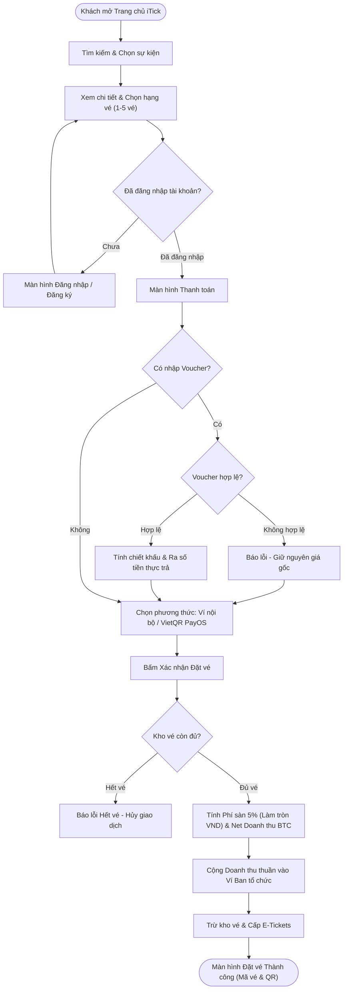

# TÀI LIỆU YÊU CẦU NGƯỜI DÙNG (URD - USER REQUIREMENTS DOCUMENT)
## DỰ ÁN: NỀN TẢNG ĐĂNG KÝ & BÁN VÉ SỰ KIỆN TRỰC TUYẾN (iTick)

- **Môn học**: Đánh giá hiệu năng / Kiểm thử phần mềm
- **Mã tài liệu**: URD-ITICK-V1.2
- **Phiên bản**: 1.2 (Đồng bộ Thương hiệu iTick, Cơ chế Thương mại Phí sàn 5%, Phê duyệt Tự động & Cổng Superadmin Toàn quyền)
- **Tác giả (Chủ hệ thống)**: Lại Thị Thanh Xuân – 23110309
- **Hệ thống**: iTick - Modern Event & Conference Ticketing Platform
- **Đối tượng bàn giao kiểm thử**: Sinh viên B (Tester)

---

> **Deploy URL**: [https://itick-platform.onrender.com/](https://itick-platform.onrender.com/)  
> **GitHub Repo**: [https://github.com/DYouth572/itick-platform](https://github.com/DYouth572/itick-platform)  
> **Google Drive**: [https://drive.google.com/drive/folders/1K9Mq0RubxVY5YOycdWN-DqwUO4dmS-kc?usp=sharing](https://drive.google.com/drive/folders/1K9Mq0RubxVY5YOycdWN-DqwUO4dmS-kc?usp=sharing)

## 1. Bối cảnh, Mục tiêu & Phạm vi (Context, Objectives & Scope)

#
> **Deploy URL**: [https://itick-platform.onrender.com/](https://itick-platform.onrender.com/)  
> **GitHub Repo**: [https://github.com/DYouth572/itick-platform](https://github.com/DYouth572/itick-platform)  
> **Google Drive**: [https://drive.google.com/drive/folders/1K9Mq0RubxVY5YOycdWN-DqwUO4dmS-kc?usp=sharing](https://drive.google.com/drive/folders/1K9Mq0RubxVY5YOycdWN-DqwUO4dmS-kc?usp=sharing)

## 1.1. Bối cảnh dự án (Context)
Trong thời đại chuyển đổi số, nhu cầu tham dự các hội thảo công nghệ, sự kiện âm nhạc, workshop kỹ năng và hội nghị chuyên môn tăng trưởng mạnh mẽ. Nền tảng **iTick** được phát triển nhằm cung cấp một giải pháp web hiện đại, chuẩn RESTful API, cho phép:
1. Ban tổ chức dễ dàng khởi tạo sự kiện, mở bán vé nhiều phân hạng và tự động kích hoạt công khai mở bán (Auto-Approval).
2. Tích hợp cơ chế thương mại dịch vụ nền tảng minh bạch: Trích thu phí dịch vụ sàn hợp lý (mặc định 5%) để duy trì hạ tầng, đồng thời tự động phân bổ doanh thu thuần vào ví Ban tổ chức.
3. Cung cấp cổng Quản trị Tối cao (Superadmin Control Center) toàn quyền giám sát người dùng, sự kiện, đơn hàng, kiểm soát đối soát dòng tiền và xử lý hoàn tiền khẩn cấp.
4. Đảm bảo môi trường hoàn hảo cho môn học Kiểm thử phần mềm: Cài cắm các bài toán bẫy lỗi kinh điển (Làm tròn số tiền VND, Cạnh tranh tài nguyên Race Condition, Boundary Testing vé 0đ, Voucher đối soát).

#
> **Deploy URL**: [https://itick-platform.onrender.com/](https://itick-platform.onrender.com/)  
> **GitHub Repo**: [https://github.com/DYouth572/itick-platform](https://github.com/DYouth572/itick-platform)  
> **Google Drive**: [https://drive.google.com/drive/folders/1K9Mq0RubxVY5YOycdWN-DqwUO4dmS-kc?usp=sharing](https://drive.google.com/drive/folders/1K9Mq0RubxVY5YOycdWN-DqwUO4dmS-kc?usp=sharing)

## 1.2. Mục tiêu dự án (Objectives)
1. **Đối với người tham dự**: Tra cứu sự kiện dễ dàng, đặt mua vé an toàn, nhận mã vé điện tử tức thì và hỗ trợ hủy vé minh bạch theo chính sách thời gian.
2. **Đối với ban tổ chức**: Tự chủ khởi tạo sự kiện mở bán ngay lập tức (không bị ách tắc chờ duyệt), theo dõi doanh thu thực nhận vào ví điện tử sau khi trừ phí sàn minh bạch.
3. **Đối với Quản trị viên (Superadmin)**: Nắm toàn quyền quản trị người dùng, phân quyền (RBAC), kiểm duyệt sự kiện, hủy đơn hoàn tiền khẩn cấp và cấu hình tỷ lệ phí sàn linh hoạt.
4. **Đối với môn học Kiểm thử & Đánh giá hiệu năng**: Cung cấp ứng dụng có 37 API Endpoints chuẩn mực, hỗ trợ đo kiểm tải cao điểm (JMeter) và kiểm thử tự động toàn diện (20/20 Test Cases PASSED).

#
> **Deploy URL**: [https://itick-platform.onrender.com/](https://itick-platform.onrender.com/)  
> **GitHub Repo**: [https://github.com/DYouth572/itick-platform](https://github.com/DYouth572/itick-platform)  
> **Google Drive**: [https://drive.google.com/drive/folders/1K9Mq0RubxVY5YOycdWN-DqwUO4dmS-kc?usp=sharing](https://drive.google.com/drive/folders/1K9Mq0RubxVY5YOycdWN-DqwUO4dmS-kc?usp=sharing)

## 1.3. Phạm vi hệ thống (Scope)
- **Trong phạm vi (In-Scope)**:
  - Quản trị tài khoản và phân quyền người dùng (Khách vãng lai, Người tham dự, Ban tổ chức, Quản trị viên).
  - Khám phá, tìm kiếm và lọc sự kiện theo từ khóa, danh mục.
  - Đặt vé, kiểm tra tồn kho theo thời gian thực, áp dụng mã voucher giảm giá, tích hợp kép thanh toán Ví nội bộ và PayOS VietQR.
  - Cơ chế thương mại & phí sàn: Tự động trích 5% phí dịch vụ, tính toán làm tròn chuẩn tiền tệ VND, chuyển doanh thu thuần về ví BTC.
  - Quản lý vé cá nhân, xuất mã vé điện tử QR/Alpha-code để check-in tại cổng.
  - Cổng Quản trị Superadmin Toàn quyền (5 Tab): Thống kê & Phí sàn, Người dùng & Phân quyền, Sự kiện, Đơn hàng & Vé, Cấu hình Hệ thống.
- **Ngoài phạm vi (Out-of-Scope)**:
  - Tích hợp cổng thanh toán quốc tế Visa/Mastercard trực tiếp (sử dụng VietQR PayOS nội địa và ví nội bộ để kiểm thử cô lập).
  - Gửi SMS Brandname vật lý – hiển thị trực tiếp mã xác thực trên giao diện web.

---

## 2. Các Vai trò Người dùng & Nhu cầu (User Roles & Needs)

Hệ thống định nghĩa **3 vai trò người dùng chính** và **1 vai trò khách vãng lai**:

| Vai trò | Mô tả đặc điểm | Nhu cầu chính (Core Needs) |
| :--- | :--- | :--- |
| **1. Khách tham dự (Attendee)** | Cá nhân tìm kiếm, đăng ký và tham gia các sự kiện, hội thảo. | • Tìm kiếm nhanh sự kiện theo sở thích, địa điểm. • Mua vé nhanh chóng, chọn thanh toán Ví hoặc quét VietQR PayOS. • Áp dụng mã voucher giảm giá hợp lệ. • Nhận mã vé điện tử tức thì để check-in. • Hủy vé nhận hoàn tiền minh bạch theo chính sách thời gian. |
| **2. Ban tổ chức (Organizer)** | Đơn vị, cá nhân tổ chức hội thảo, sự kiện. | • Tạo sự kiện và mở bán tức thì nhờ cơ chế Tự động phê duyệt (Auto-Approval). • Phân chia nhiều hạng vé (VIP, Standard, Early Bird) linh hoạt. • Tự động nhận doanh thu thuần vào ví điện tử sau khi trích phí sàn 5%. • Soát vé tại cổng nhanh chóng, chính xác, phát hiện ngay vé giả/vé đã dùng. • Theo dõi báo cáo tài chính đối soát minh bạch. |
| **3. Quản trị viên (Superadmin)** | Người quản trị tối cao, nắm toàn quyền điều hành hệ thống iTick. | • Toàn quyền quản trị tài khoản người dùng và nâng/hạ vai trò (RBAC). • Giám sát toàn bộ sự kiện toàn sàn, ẩn/hiện hoặc xóa sự kiện vi phạm. • Quản trị đơn hàng toàn sàn, thực hiện **Hủy đơn khẩn cấp & Hoàn 100% tiền** cho khách khi có tranh chấp (tự động thu hồi số dư từ ví BTC). • Cấu hình tỷ lệ phần trăm phí sàn linh hoạt (`platform_fee_rate`). • Báo cáo tổng thể doanh thu, phí sàn, chi trả BTC với độ lệch đối soát bằng 0đ. |
| **Khách vãng lai (Guest)** | Người dùng chưa đăng nhập vào hệ thống. | • Xem danh sách sự kiện công khai, đọc chi tiết chương trình, xem bảng giá vé trước khi đăng ký tài khoản. |

---

## 3. Các Luồng Nghiệp vụ Trọng Yếu (User Business Flows)

### FLOW-01: Khám phá Sự kiện, Đặt mua Vé, Tính Phí Sàn & Phân Bổ Doanh Thu

##
> **Deploy URL**: [https://itick-platform.onrender.com/](https://itick-platform.onrender.com/)  
> **GitHub Repo**: [https://github.com/DYouth572/itick-platform](https://github.com/DYouth572/itick-platform)  
> **Google Drive**: [https://drive.google.com/drive/folders/1K9Mq0RubxVY5YOycdWN-DqwUO4dmS-kc?usp=sharing](https://drive.google.com/drive/folders/1K9Mq0RubxVY5YOycdWN-DqwUO4dmS-kc?usp=sharing)

## 1. Mô tả chi tiết nghiệp vụ từ góc nhìn người dùng
- **Điểm bắt đầu**: Người dùng mở trang chủ iTick, tìm kiếm và chọn sự kiện yêu thích.
- **Bước 1 - Chọn vé & Số lượng**: Người dùng chọn hạng vé và số lượng (1 - 5 vé).
- **Bước 2 - Áp dụng Voucher (nếu có)**: Nhập mã giảm giá. Hệ thống thẩm định điều kiện và tính chiết khấu hợp lệ.
- **Bước 3 - Xác nhận Thanh toán & Phân bổ Dòng tiền**:
  - Người dùng chọn phương thức thanh toán: Ví nội bộ hoặc Quét mã VietQR qua PayOS.
  - Khi đơn hàng hoàn tất, hệ thống kích hoạt tự động cơ chế thương mại:
    - **Phí dịch vụ nền tảng iTick (5%)**: $\text{platform\_fee} = \text{round}(\text{final\_amount} \times 5\%)$ được ghi nhận vào doanh thu sàn.
    - **Doanh thu thuần của Ban tổ chức**: $\text{organizer\_amount} = \text{final\_amount} - \text{platform\_fee}$ được tự động ghi có vào số dư ví của Organizer.
    - Trừ tồn kho vé tức thì, cấp mã vé điện tử định danh cho khách hàng.

#### 2. Sơ đồ Flow nghiệp vụ (User Flow Diagram)

---

### FLOW-02: Ban tổ chức Tạo sự kiện & Tự động Phê duyệt Mở bán (Auto-Approval Flow)

##
> **Deploy URL**: [https://itick-platform.onrender.com/](https://itick-platform.onrender.com/)  
> **GitHub Repo**: [https://github.com/DYouth572/itick-platform](https://github.com/DYouth572/itick-platform)  
> **Google Drive**: [https://drive.google.com/drive/folders/1K9Mq0RubxVY5YOycdWN-DqwUO4dmS-kc?usp=sharing](https://drive.google.com/drive/folders/1K9Mq0RubxVY5YOycdWN-DqwUO4dmS-kc?usp=sharing)

## 1. Mô tả chi tiết nghiệp vụ từ góc nhìn người dùng
- Ban tổ chức đăng nhập, vào mục "Quản lý sự kiện" $\rightarrow$ "Tạo sự kiện mới".
- Nhập thông tin: Tiêu đề, danh mục, thời gian tổ chức, địa điểm, sức chứa và ảnh banner.
- **Cơ chế Tự động Phê duyệt (Auto-Approval)**: Hệ thống tự động kiểm tra các ràng buộc dữ liệu. Nếu hợp lệ, sự kiện lập tức nhận trạng thái `PUBLISHED` và kích hoạt hiển thị `is_visible = True` để mở bán ngay cho khách hàng, không còn cảnh chờ duyệt thủ công.

---

### FLOW-03: Soát vé tại Cổng Sự kiện & Xuất Báo Cáo Đối Soát Timeline (Check-in & Attendee Reconciliation Flow)
- **Nghiệp vụ Soát vé tại Cổng**:
  - Nhân viên soát vé mở giao diện Check-in, quét mã QR qua webcam/camera điện thoại hoặc bắn mã vạch USB/gõ mã vé điện tử.
  - Hệ thống thẩm định:
    - Vé hợp lệ (`CONFIRMED`): Đổi trạng thái sang `CHECKED_IN`, lưu mốc giờ check-in thực tế, màn hình hiển thị **XANH LÁ** kèm âm thanh bíp thành công.
    - Vé đã dùng (`CHECKED_IN`): Báo động **ĐỎ RỰC**, phát âm thanh cảnh báo, hiển thị chi tiết thời gian đã quét trước đó.
    - Vé đã hủy (`CANCELLED`): Báo từ chối vào cửa do vé đã hoàn tiền.
    - Vé quá hạn (`EXPIRED`): Báo từ chối do sự kiện đã kết thúc mà khách không đến đúng giờ.
- **Nghiệp vụ Xuất File Excel Đối Soát Điểm Danh & Trạng Thái Tham Dự**:
  - Ban tổ chức bấm nút **"Xuất Excel Soát Vé"** trong Tab "Quản lý người đăng ký theo từng sự kiện".
  - Hệ thống sinh file CSV chuẩn **UTF-8 BOM (`\ufeff`)** mở trực tiếp trên Excel không bị lỗi font tiếng Việt.
  - Tự động đối chiếu theo timeline sự kiện:
    - `ĐÃ THAM DỰ`: Đã qua cổng quét vé thành công, lưu rõ giờ phút giây check-in.
    - `VẮNG MẶT`: Khách mua vé nhưng không đến tham dự sau khi sự kiện kết thúc.
    - `CHƯA CHECK-IN`: Khách mua vé hợp lệ, đang trong thời hạn chờ vào cửa.
    - `ĐÃ HỦY VÉ`: Vé đã được hoàn tiền trước sự kiện.

---

### FLOW-04: Yêu cầu Hủy vé Cá nhân & Hoàn tiền theo Chính sách
- Khách hàng yêu cầu hủy vé trong mục "Vé của tôi":
  - $\ge 48$ giờ trước sự kiện: Phí hủy 10%, hoàn lại 90% giá vé vào ví.
  - $24$ đến $< 48$ giờ: Phí hủy 30%, hoàn lại 70% giá vé vào ví.
  - $< 24$ giờ: Không hỗ trợ hủy sát giờ.

---

## 4. Danh sách 15 User Stories & Tiêu chí Nghiệm thu Chi tiết (Given - When - Then)

### Nhóm 1: Tài khoản & Xác thực (Authentication)

#### US-01: Đăng ký Tài khoản mới
- **User Story**: **Là** khách vãng lai, **tôi muốn** đăng ký tài khoản bằng email và mật khẩu, **để** tôi có thể đăng nhập để mua vé hoặc tạo sự kiện.
- **Độ ưu tiên**: **Must Have**
- **Tiêu chí nghiệm thu (Acceptance Criteria)**:
  - *Given*: Khách vãng lai ở màn hình Đăng ký tài khoản.
  - *When*: Nhập họ tên hợp lệ, email chưa tồn tại, mật khẩu từ 6 ký tự gồm chữ và số, chọn vai trò và bấm "Đăng ký".
  - *Then*: Hệ thống tạo tài khoản thành công, thông báo đăng ký thành công và chuyển sang màn hình Đăng nhập.

#### US-02: Đăng nhập Hệ thống & Cấp phiên làm việc
- **User Story**: **Là** người dùng đã có tài khoản, **tôi muốn** đăng nhập bằng email và mật khẩu, **để** tôi được xác thực phiên làm việc JWT và thao tác theo vai trò.
- **Độ ưu tiên**: **Must Have**

---

### Nhóm 2: Khám phá & Đặt vé (Booking & Platform Fee)

#### US-05: Đặt mua Vé, Tính Phí Sàn 5% & Tự động Phân bổ Doanh thu
- **User Story**: **Là** người tham dự, **tôi muốn** đặt mua vé trực tuyến và chọn thanh toán linh hoạt, **đồng thời** hệ thống tự động trích 5% phí sàn và chuyển doanh thu thuần cho Ban tổ chức.
- **Độ ưu tiên**: **Must Have**
- **Tiêu chí nghiệm thu (Acceptance Criteria)**:
  - **Kịch bản 5.1 (Đặt vé thành công & phân bổ dòng tiền chuẩn)**:
    - *Given*: Sự kiện có vé giá 300,000đ, khách mua 2 vé (Tổng tiền 600,000đ).
    - *When*: Khách bấm "Xác nhận đặt vé" và thanh toán thành công.
    - *Then*: Hệ thống tính phí sàn iTick 5% = 30,000đ (làm tròn số nguyên VND), doanh thu thuần BTC = 570,000đ. Số dư ví Ban tổ chức tự động cộng +570,000đ ngay lập tức; cấp 2 mã vé điện tử `CONFIRMED`.
  - **Kịch bản 5.2 (Vé miễn phí 0đ)**:
    - *Given*: Sự kiện vé 0đ.
    - *When*: Khách đăng ký 1 vé.
    - *Then*: Tổng tiền = 0đ, Phí sàn = 0đ, Tiền chuyển BTC = 0đ. Hệ thống không trừ tiền và không cộng ví, cấp vé thành công mà không gây lỗi chia cho 0.
  - **Kịch bản 5.3 (Làm tròn số tiền VND khi áp Voucher)**:
    - *Given*: Vé giá 199,000đ, khách áp voucher giảm 10% còn 179,100đ.
    - *When*: Hệ thống tính phí sàn 5%.
    - *Then*: $\text{Phí sàn} = \text{round}(179,100 \times 5\%) = 8,955đ$, doanh thu thuần BTC = 170,145đ. Số tiền hoàn toàn là số nguyên không có số thập phân lẻ.

---

### Nhóm 3: Ban tổ chức & Quản lý Sự kiện (Organizer)

#### US-09: Khởi tạo Sự kiện & Tự động Phê duyệt Mở bán (Auto-Approval)
- **User Story**: **Là** ban tổ chức, **tôi muốn** tạo sự kiện mới và hệ thống tự động kiểm duyệt mở bán ngay lập tức, **để** tôi không phải chờ đợi quản trị viên duyệt thủ công.
- **Độ ưu tiên**: **Must Have**
- **Tiêu chí nghiệm thu (Acceptance Criteria)**:
  - *Given*: Ban tổ chức đã đăng nhập vào mục "Quản lý sự kiện".
  - *When*: Nhập thông tin sự kiện hợp lệ (tiêu đề, thời gian tương lai, địa điểm, sức chứa) và bấm "Lưu".
  - *Then*: Hệ thống tự động cấp trạng thái `PUBLISHED` và kích hoạt `is_visible = True` ngay lập tức, sự kiện xuất hiện ngay trên trang chủ để khách hàng có thể tìm thấy và mua vé.

#### US-11: Soát vé tại Cổng Sự kiện
- **User Story**: **Là** nhân viên soát vé, **tôi muốn** quét mã vé hoặc QR để xác thực khách vào cửa, **để** tôi kiểm soát người tham dự và ngăn chặn vé giả mạo.
- **Độ ưu tiên**: **Must Have**

#### US-12: Báo cáo Doanh thu & Đối soát Dòng tiền
- **User Story**: **Là** ban tổ chức, **tôi muốn** xem thống kê số lượng vé đã bán và doanh thu thực nhận sau khi trừ phí dịch vụ nền tảng 5%, **để** tôi đối soát tài chính minh bạch.
- **Độ ưu tiên**: **Should Have**
- **Tiêu chí nghiệm thu (Acceptance Criteria)**:
  - *Given*: Ban tổ chức mở trang Báo cáo của sự kiện.
  - *When*: Sự kiện bán được 10,000,000đ tiền vé gộp.
  - *Then*: Báo cáo hiển thị rõ: Doanh thu gộp (10,000,000đ), Phí dịch vụ sàn iTick 5% (-500,000đ), Doanh thu thực nhận (+9,500,000đ) đúng bằng số dư đã ghi nhận vào ví.

#### US-12b: Xuất File Excel Danh Sách Soát Vé & Đối Soát Trạng Thái Tham Dự
- **User Story**: **Là** ban tổ chức sự kiện, **tôi muốn** xuất file Excel (.xlsx) danh sách người tham dự và mã vé của từng sự kiện với giao diện trực quan, chuyên nghiệp và có **cột Trạng thái soát vé dạng Dropdown thả xuống**, **để** phục vụ việc nạp danh sách vào cổng soát vé, cho phép nhân viên soát vé click chọn điểm danh trực tiếp trên Excel, và tự động đối soát chính xác ai đã tham dự, ai vắng mặt sau khi sự kiện kết thúc.
- **Độ ưu tiên**: **Must Have**
- **Tiêu chí nghiệm thu (Acceptance Criteria)**:
  - *Given*: Ban tổ chức đang ở Tab "Quản lý người đăng ký theo từng sự kiện".
  - *When*: Bấm nút "Xuất Excel Soát Vé" (`GET /api/events/{event_id}/export-attendees?format=xlsx`).
  - *Then*: File tải xuống ngay lập tức với định dạng Excel chuẩn (`.xlsx`), mở trực tiếp bằng Microsoft Excel với giao diện căn chỉnh đẹp mắt, tự động co giãn độ rộng cột, khóa dòng tiêu đề, có Data Validation Dropdown ở cột "Trạng thái soát vé" (`ĐÃ THAM DỰ`, `VẮNG MẶT`, `CHƯA CHECK-IN`, `ĐÃ HỦY VÉ`); đồng thời hỗ trợ xuất `format=csv` (UTF-8 BOM) và `format=json` khi cần tích hợp máy quét tự động.

---

### Nhóm 4: Quản trị Hệ thống Tối cao (Superadmin)

#### US-13: Superadmin Quản trị Toàn quyền Người dùng & Phân quyền (RBAC)
- **User Story**: **Là** quản trị viên tối cao, **tôi muốn** có toàn quyền xem, thêm, sửa, đổi vai trò (Role), đặt lại mật khẩu và khóa/mở khóa mọi tài khoản trên hệ thống, **để** tôi duy trì kỷ luật và an toàn thông tin toàn sàn.
- **Độ ưu tiên**: **Must Have**
- **Tiêu chí nghiệm thu (Acceptance Criteria)**:
  - *Given*: Admin ở Tab "Người dùng & Phân quyền" của trang Quản trị.
  - *When*: Admin thực hiện đổi vai trò của tài khoản từ `ATTENDEE` sang `ORGANIZER` hoặc bấm "Khóa tài khoản".
  - *Then*: Quyền hạn mới có hiệu lực tức thì; tài khoản bị khóa không thể đăng nhập vào hệ thống (HTTP 403 Forbidden).

#### US-14: Quản trị Sự kiện & Vé Điện tử Toàn sàn
- **User Story**: **Là** quản trị viên, **tôi muốn** có quyền ẩn/hiện hoặc xóa sự kiện vi phạm, đồng thời vô hiệu hóa các vé gian lận, **để** tôi bảo vệ uy tín nền tảng iTick.
- **Độ ưu tiên**: **Must Have**

#### US-15: Cấu hình Tỷ lệ Phí Sàn & Hủy Đơn Hoàn Tiền Khẩn Cấp
- **User Story**: **Là** quản trị viên tối cao, **tôi muốn** cấu hình tỷ lệ phí sàn linh hoạt và có quyền hủy đơn khẩn cấp hoàn tiền 100% cho khách, **để** tôi giải quyết các tranh chấp khiếu nại và đảm bảo đối soát dòng tiền cân bằng tuyệt đối.
- **Độ ưu tiên**: **Must Have**
- **Tiêu chí nghiệm thu (Acceptance Criteria)**:
  - **Kịch bản 15.1 (Cấu hình phí sàn nền tảng)**:
    - *Given*: Tỷ lệ phí sàn đang là 5.0%.
    - *When*: Admin cập nhật tỷ lệ phí sàn mới thành 6.5% (`PUT /api/admin/system/fee`).
    - *Then*: Hệ thống lưu cấu hình thành công, mọi đơn hàng mới phát sinh sau thời điểm này sẽ được tính phí dịch vụ 6.5%.
  - **Kịch bản 15.2 (Hủy đơn khẩn cấp & Hoàn tiền 100%)**:
    - *Given*: Đơn hàng trị giá 480,000đ (Phí sàn 24,000đ, BTC đã nhận 456,000đ vào ví).
    - *When*: Superadmin bấm nút "Hoàn tiền khẩn cấp" (`POST /api/admin/orders/{id}/refund`).
    - *Then*: Khách hàng được hoàn trả đủ 480,000đ; Ví Ban tổ chức bị tự động khấu trừ thu hồi lại đúng 456,000đ; Doanh thu phí sàn giảm 24,000đ; Toàn bộ vé trong đơn chuyển sang `CANCELLED`; Kho vé khả dụng được cộng trả lại.
  - **Kịch bản 15.3 (Bảo toàn dòng tiền đối soát sàn)**:
    - *Given*: Tổng doanh thu gộp, doanh thu phí sàn, chi trả BTC và tổng tiền hoàn trả.
    - *When*: Admin xem báo cáo đối soát tại `GET /api/admin/stats`.
    - *Then*: Phương trình đối soát luôn cân bằng tuyệt đối: $\text{Gross} = \text{Platform Fee} + \text{Organizer Payout} + \text{Refunded}$, độ lệch đối soát bằng 0 VNĐ.

---

## 5. Tiêu chí Nghiệm thu Tổng thể ở Mức Người dùng (Overall Acceptance Criteria)

1. **Khả năng sử dụng & Thẩm mỹ (Usability & Aesthetics)**: Giao diện Ambient Aurora Mesh hiện đại, hỗ trợ chuyển đổi mượt mà giữa chế độ Sáng và Tối (Dual Theme). Mọi thông báo lỗi hiển thị bằng tiếng Việt thân thiện, rõ ràng.
2. **Minh bạch Tài chính & Toàn vẹn Dữ liệu (Financial Transparency & Integrity)**: Tỷ lệ phí sàn, chiết khấu voucher và doanh thu thực nhận hiển thị chi tiết, minh bạch ở mọi khâu. Tuyệt đối không xảy ra hiện tượng thất thoát tiền hay sai lệch số dư ví.
3. **Tính sẵn sàng của vé điện tử (E-Ticket Availability)**: Mã vé và mã QR sẵn sàng ngay lập tức sau thanh toán, hỗ trợ quét check-in mượt mà tại cổng sự kiện.
